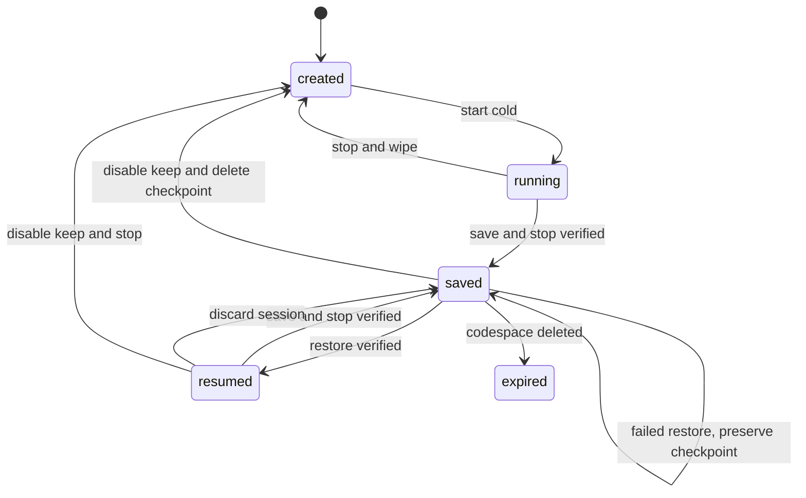
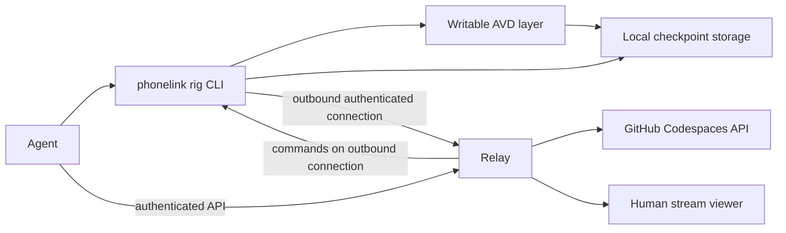
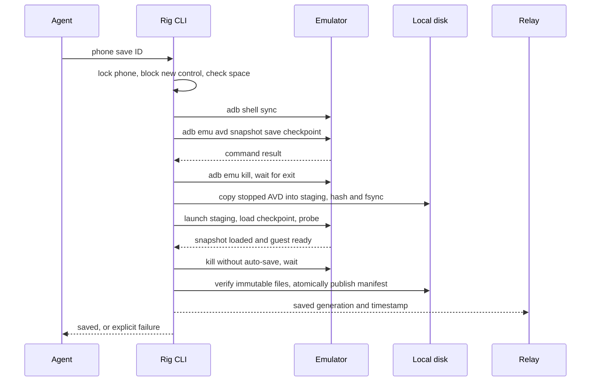
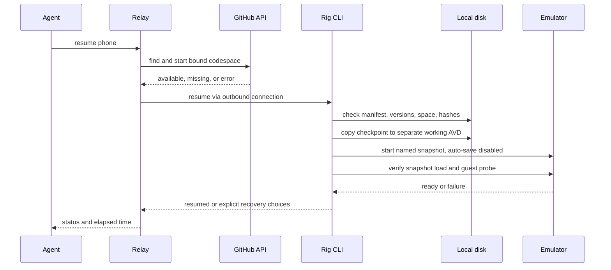

Keep is opt-in per phone; wipe remains the default.
A save commits a verified, immutable checkpoint on the codespace disk.
Resume restores that checkpoint; later writes remain uncommitted until the next save.
The under-20-second target is a release gate, not a proven guarantee.
The design detects missing, incompatible, and corrupt checkpoints and reports recovery choices.









## Where the code goes

Two layers. The **relay** runs on our host and holds no Android data. The **rig** runs inside the user's codespace, next to the emulator, and owns every file that a save touches.

```
phonelink/                       repo, published from our host
├── bin/phonelink                one entry command, bash, no build step
├── lib/                         the rig: runs inside the codespace
│   ├── cli.sh                   argument parsing, JSON output, exit codes
│   ├── phone.sh                 create, start, stop, status, keep on/off
│   ├── avd.sh                   writable AVD build, config patch, phone lock
│   ├── snapshot.sh              save, verify, resume, recover, discard
│   ├── manifest.sh              generation manifest: hashes, versions, fsync
│   ├── space.sh                 disk admission, quota estimate, warnings
│   ├── gh.sh                    codespace start/stop, retention, token calls
│   └── relay.sh                 outbound connection, operation ids, retries
├── skill/skill.md               what the agent reads, served at /skill.md
├── relay/                       our host, TypeScript on Node, no Android data
│   ├── src/server.ts            HTTP API, stream fan-out, auth
│   ├── src/api/phones.ts        the phone endpoints from this plan
│   └── src/api/operations.ts    long-running operation records
├── tests/
│   ├── unit/                    bash tests for manifest, admission, parsing
│   ├── integration/             real emulator runs on one slot
│   └── fixtures/                tiny fake AVD trees, corrupt manifest samples
├── scripts/dev/                 developer-only helpers, never installed
│   ├── bench-multi-emu.sh       the 1/2/3 phone stress test
│   └── trial-save-resume.sh     phase 1 hand-run: save, resume, time it
├── docs/                        this plan, the problem statement, the record
└── site/                        landing page, published to here.now
```

The rig installs into the codespace at `~/.phonelink/`, so it survives a stop and never needs a system path:

```
~/.phonelink/
├── bin/phonelink                copy of the repo bin, on PATH for the agent
├── lib/                         copy of the repo lib
├── state.json                   phone registry, keep flags, last save times
├── lock                         one slot-wide writer lock
└── phones/<phone-id>/
    ├── avd/                     writable AVD, the only live one
    ├── working/                 resumed copy, deleted on stop
    ├── generations/<gen>/       committed checkpoints, immutable
    ├── staging/                 in-progress save, deleted on failure
    └── manifest.json            current generation pointer, replaced atomically
```

Rules for this layout:

1. `bin/` and `lib/` are copied, never symlinked. A codespace must run the version it was installed with.
2. `generations/` is append-only. Only `manifest.json` decides which generation is current.
3. `staging/` and `working/` are always safe to delete. Cleanup never touches `generations/`.
4. Nothing outside `~/.phonelink/` holds phone state. The relay database holds only phone id, owner, and codespace binding.

Where the existing rig scripts go. The current scripts in `~/.agents/skills/android-emu/scripts/` are the seed of `lib/`, not a separate system:

| Today | Becomes | Phase |
|---|---|---|
| `ghctx.sh` | `lib/gh.sh` | 4 |
| `setup.sh` | `lib/avd.sh` | 1 |
| `boot.sh` | `lib/phone.sh start` | 1 |
| `stop.sh` | `lib/phone.sh stop` | 1 |
| `status.sh` | `lib/phone.sh status` | 2 |
| `bench-multi-emu-v2.sh` | `scripts/dev/bench-multi-emu.sh` | 5 |

The skill keeps working during the move. `skill/skill.md` names the new commands, and the old scripts stay until the new ones pass the same tests.

## Phases

1. **One-day vertical slice.** On one existing codespace, create one writable AVD and manually opt it in. Implement save, immutable checkpoint copy, resume, and a guest marker probe. Record every command result and elapsed time. Test install, file, and app-data survival; kill during save; compare resume against 20 seconds. This is a feasibility slice, not a production guarantee. Confirm actual emulator flags, checkpoint file completeness, and shutdown behavior on the pinned version. Files: `bin/phonelink`, `lib/cli.sh`, `lib/avd.sh`, `lib/snapshot.sh`, `scripts/dev/trial-save-resume.sh`.
2. **Atomic saves and disk admission.** Add generation directories, a manifest, checksums, locking, staging, and recovery from interrupted publication. Test process termination at each boundary, ENOSPC during copy, two concurrent saves, and recovery of the previous generation. Files: `lib/manifest.sh`, `lib/space.sh`, `lib/snapshot.sh`, `lib/phone.sh status`, `tests/unit/`.
3. **Lifecycle and isolation.** Add per-phone keep, wipe, resume, and disable controls. Test two phones with only one kept, concurrent control exclusion, unsaved-write discard, and changed disk capacity. Test deliberate image corruption and emulator/system image mismatch. Files: `lib/phone.sh`, `lib/avd.sh`, `tests/integration/lifecycle.sh`.
4. **Relay and account integration.** Add authenticated lifecycle APIs, outbound reconnection, operation IDs, and missing-codespace status. Test relay disconnects, duplicate requests, authorization boundaries, token revocation, and a deleted codespace. Do not exercise destructive account actions against a real account without a disposable fixture. Files: `relay/`, `lib/relay.sh`, `lib/gh.sh`, `skill/skill.md`.
5. **Measurement and release.** Measure end-to-end restore to usable guest, including copying and verification, for one and two phones. Test repeated saves, unplanned codespace stops, idle expiry handling, software-rendered snapshot reliability, and full-disk behavior. Publish latency distribution and failure rate. Do not promise under 20 seconds until the target passes on the supported configuration. Files: `scripts/dev/`, `tests/integration/`, `docs/`.

## Save contract

A generation is the complete stopped AVD directory and its required configuration, plus a manifest. It contains the named snapshot, associated disk images, hashes, version identifiers, and creation time. The exact set of files required for a portable local generation is **UNVERIFIED** and must be established in phase 1. Copies must preserve sparse files where supported; budget for full allocated copies if they do not.

For a kept phone, the rig grants one writer and blocks new agent and viewer input during save. It waits for in-flight commands, runs `adb -s SERIAL shell sync`, then `adb -s SERIAL emu avd snapshot save checkpoint`. It checks the console response and snapshot list. `sync` is best effort; it does not guarantee that an application has committed its own transactions. The rig sends `adb -s SERIAL emu kill` and waits for qemu to exit. It never calls a save successful solely because a signal was sent.

The rig copies the stopped AVD into a fresh staging generation. It hashes all required immutable files, flushes files and directories, and tests restore from a separate working copy. The test checks an explicit successful snapshot-load indication and guest readiness. The rig stops the test emulator with auto-save disabled. It then atomically renames the staged generation and atomically replaces a flushed current-generation manifest. Only that manifest replacement commits the save. Keep the previous generation until the new one commits. A crash leaves either the previous manifest or the new one, never a claimed partial generation. Filesystem atomic rename and directory fsync behavior must be tested on the actual codespace filesystem.

Every resume copies a committed generation to a separate working AVD. This isolates the committed copy from qemu writes. Writes after a save exist only in that working copy. A later save commits them; an unplanned stop, discard, or failed save loses them. Save before an intentional codespace stop; an unexpected stop has no reliable final-save guarantee. Report the last successful save time and dirty status. Do not claim that a save includes writes issued after input was blocked. Tests must establish whether guest services writing during snapshot creation affect application consistency.

Launch with the pinned AVD and `-snapshot checkpoint -no-snapshot-save`; validate the exact behavior on the pinned emulator. Android documents named snapshots, console commands, and automatic cold fallback when a named snapshot is absent: [command-line options](https://developer.android.com/studio/run/emulator-commandline), [console commands](https://developer.android.com/studio/run/emulator-console). A booted guest alone is therefore insufficient proof of snapshot load. **UNVERIFIED:** the pinned emulator exposes an unambiguous machine-readable load-success signal; phase 1 must identify and test one. Until then report restore as unverified, not resumed. Android warns snapshots are unreliable with software rendering, which the measured rig uses: [snapshot documentation](https://developer.android.com/studio/run/emulator-snapshots).

## Storage and admission

The following are planning caps in decimal GB, not measured component sizes. Measure `du` and actual free bytes on each slot. The baseline discussion reports a roughly 26 GB ready slot, so these caps require validation before adoption.

| Path or use | Cap, GB |
|---|---:|
| OS, base container, tools | 8 |
| Android SDK excluding system image | 4 |
| Pinned Android system image | 3 |
| Project, Gradle and other caches | 4 |
| Two committed phones, 2 GB each | 4 |
| One active working phone | 2 |
| One staging generation and verification working copy | 4 |
| Filesystem free reserve | 3 |
| Total | 32 |

A second active working phone consumes another 2 GB and requires equivalent headroom elsewhere. Snapshot RAM and copy size may exceed these caps. Block admission if measured space cannot cover the actual source allocated bytes, a full staging copy, a verification copy, and 3 GB reserve. Reserve space for only one save at a time using a slot-wide lock. Warn when free space falls below the projected next-save requirement plus 1 GB, before writes reach that boundary. Recheck immediately before each allocation. On ENOSPC, remove only incomplete staging and retain the committed generation. Never automatically remove a kept phone. Offer cleanup of disposable working AVDs, regenerable build caches, and obsolete unreferenced staging, in that order. Delete a prior generation only after successful publication. If a new machine has a different disk size, recompute from actual free bytes and decline the operation if admission fails.

## Quota and expiry

GitHub counts Codespaces storage in GB-hours across the billing period, including stopped codespaces. Base image accounting, other codespaces, and prebuilds mean local `du` is not the account bill. See [GitHub storage guidance](https://docs.github.com/en/codespaces/troubleshooting/troubleshooting-included-usage). Estimate incremental usage as measured billable GB × retained hours divided by the billing month's hours. Add this to user-supplied or independently available account usage. Warn at a projected 16 of 20 GB-month, and warn immediately if already above it. Mark the estimate unknown when account-wide usage is unavailable. Do not claim 20 GB-month applies to all plans: GitHub currently lists 15 GB for Free and 20 GB for Pro in its [plan table](https://docs.github.com/en/billing/reference/product-usage-included). The input's 180 core-hours and 20 GB-month correspond to its Pro scenario. A 4-core slot consumes 4 core-hours per hour; 180 gives 45 hours before other usage.

GitHub's default stopped retention is 30 days and can be shorter. See [retention settings](https://docs.github.com/en/codespaces/setting-your-user-preferences/configuring-automatic-deletion-of-your-codespaces). Record the actual known retention setting and last stop time when available. Label expiry estimates as estimates. On a confirmed missing codespace, mark the phone expired and explain that local state is gone. Authentication failures and transient API failures are unknown, not expiry. The relay stores only phone metadata and the codespace binding, never a backup of Android data.

## Validation and recovery

Before launch, validate manifest schema, file sizes, SHA-256 hashes, and pinned emulator, system image, and AVD configuration identities. Never hash files while qemu can mutate them. Launch only a separate copy. Require both explicit snapshot-load success and a bounded guest probe: adb online, `sys.boot_completed=1`, and a guest marker created before save. This detects some failures, not every application-level corruption. Include an optional app-specific probe. Report slow resume separately from failure.

On mismatch, failed hash, failed load, or failed probe, preserve the checkpoint and return a specific error. Offer the last verified generation if one exists. Otherwise offer an explicit cold boot from a separate copy of saved userdata, labeled recovery and not a successful resume. Its ability to recover data is **UNVERIFIED**. Offer a clean phone only with explicit user choice. Do not silently wipe. A changed system image or emulator invalidates snapshot compatibility; retain pinned versions where possible. If unavailable, use the same explicit recovery path. Android documents version and configuration invalidation in its [snapshot guidance](https://developer.android.com/studio/run/emulator-snapshots).

## API and control

All commands return JSON with phone ID, operation ID, state, last saved time, dirty flag, and structured error. Commands are idempotent when supplied the same operation ID. `phonelink phone create` defaults to wipe; `phonelink phone keep ID --on` opts in; `phonelink phone save ID` saves and stops; `phonelink phone resume ID` resumes; `phonelink phone status ID` reports state, capacity, and warnings; `phonelink phone stop ID --discard` discards session writes; `phonelink phone keep ID --off` deletes kept state after explicit confirmation. `phonelink phone recover ID --generation GEN` selects an existing generation. `phonelink phone delete ID` requires explicit confirmation before deleting kept state.

Relay endpoints: `POST /v1/phones`, `GET /v1/phones/{id}`, `PATCH /v1/phones/{id}` for keep preference, `POST /v1/phones/{id}/save`, `POST /v1/phones/{id}/resume`, `POST /v1/phones/{id}/stop`, `POST /v1/phones/{id}/recover`, and `DELETE /v1/phones/{id}`. Long operations return an operation ID; `GET /v1/operations/{id}` reports progress. The authenticated outbound rig connection carries commands and status; the existing stream channel carries video. Enforce phone ownership and one controller. Never expose adb or GitHub tokens through the viewer.

Use the chosen OAuth app with `codespace` scope and encrypted token storage. Provide revocation through `DELETE /applications/{client_id}/token` using the required application authentication; verify endpoint requirements against [GitHub's OAuth API](https://docs.github.com/en/rest/apps/oauth-applications). Token refresh and expiration support for this specific OAuth app flow is **UNVERIFIED**. Do not assume revocation deletes a codespace or its phone data.

The measured 4-vCPU slot uses 180% CPU for one phone, 306% for two, and 394% for three. Available RAM at two and three was 8.4 GB and 5.4 GB. Cold boots took 40, 56, and 64 seconds respectively. Default to one phone; support two as the solid limit. Treat three as light-work-only and do not include it in the persistence release target. CPU saturates before RAM in that test.
